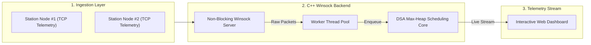

<div align="center">

  <!-- Hero Banner -->
  

  <!-- Animated Subheading -->
  <a href="https://github.com/sanjaysivakumar07">
    
  </a>

  <br/><br/>

  <!-- Social & Contact Buttons -->
  <p align="center">
    <a href="https://www.linkedin.com/in/sanjay-s-2757ba42a" target="_blank">
      
    </a>
    <a href="mailto:sanjaysivakumar218@gmail.com" target="_blank">
      
    </a>
    <a href="https://github.com/sanjaysivakumar07" target="_blank">
      
    </a>
  </p>

  <p align="center">
    
    
    
  </p>

</div>

---

### 💻 Developer Profile & Engineering Focus

```typescript
/**
 * @fileoverview Engineer Specification
 * @author Sanjay Sivakumar <sanjaysivakumar218@gmail.com>
 */

const engineer = {
  identity: "Sanjay Sivakumar",
  role: "Systems & Backend Software Engineer",
  coreDomains: [
    "High-Performance Computing (C++20)",
    "Socket Networking (Winsock / POSIX)",
    "Concurrent Systems & Multi-Threading",
    "Data Structures & Algorithm Optimization",
    "Modern Full-Stack Applications"
  ],
  architecturalPatterns: [
    "Non-blocking I/O Event Loops",
    "Thread-Pool Worker Dispatching",
    "Priority Queues & Dynamic Load Scheduling"
  ],
  mission: "Building resilient, high-throughput network engines and clean backend services.",
  status: "Open to Software Engineering Opportunities & Collaborations"
};
```

---

### ⚡ Highlighted Project: Smart EV Charging System

A full-stack, real-time electric vehicle slot scheduling system powered by a native **C++ Winsock HTTP Server** and interactive web telemetry HUD.



- **Multi-Threaded Socket Engine:** Low-overhead client connection handling using C++ & Winsock.
- **DSA Priority Queue (Max-Heap):** Dynamically prioritizes emergency vehicles and earliest departure schedules.
- **Real-Time Client Dashboard:** Live interactive UI streaming station occupancy and tariff calculations.

👉 **[Explore Smart-EV-Charging-System Repository →](https://github.com/sanjaysivakumar07/Smart-EV-Charging-System)**

---

### 🛠️ Technical Arsenal

<div align="center">

| Domain | Technologies & Tools |
| :--- | :--- |
| **Languages** | `C++20` `C` `Python` `JavaScript` `TypeScript` `HTML5` `CSS3` |
| **Systems & Networking** | `Winsock API` `POSIX Sockets` `Multi-Threading (std::thread)` `TCP/IP` `REST APIs` |
| **Data Structures & Algorithms** | `Max/Min Heaps` `Priority Queues` `Linked Lists` `LIFO Stacks` `Graph Traversal` |
| **Databases & Tools** | `SQL` `Git` `GitHub` `VS Code` `Postman` `PowerShell` `Bash` |

<br/>


</div>

---

### 📈 Activity & Contribution Overview

<div align="center">

  <!-- Snake Contribution Animation with Absolute GitHub Raw URL -->
  <p><b>Dynamic Contribution Activity</b></p>
  

  <br/><br/>

  <!-- 3D Isometric Contribution Grid with Absolute Raw URL -->
  

  <br/><br/>

  <!-- Streak Stats Card -->
  

</div>

---

### 📬 Connect With Me

<div align="center">

[](https://www.linkedin.com/in/sanjay-s-2757ba42a)
[](mailto:sanjaysivakumar218@gmail.com)
[](https://github.com/sanjaysivakumar07)

<br/>


</div>
