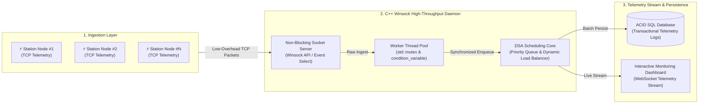
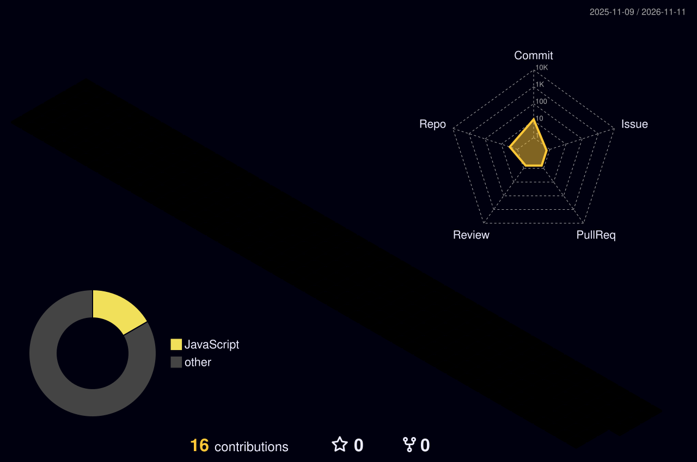

<div align="center">

  <!-- 🌌 Futuristic Oceanic Hero Wave Banner -->
  

  <!-- ⚡ Animated JetBrains Mono Typing Subheading -->
  <a href="https://github.com/sanjaysivakumar07">
    
  </a>

  <br/><br/>

  <!-- 🌐 Interactive Command Ribbon -->
  <p align="center">
    <a href="https://www.linkedin.com/in/sanjay-s-2757ba42a" target="_blank">
      
    </a>
    <a href="mailto:sanjaysivakumar218@gmail.com" target="_blank">
      
    </a>
    <a href="https://github.com/sanjaysivakumar07" target="_blank">
      
    </a>
  </p>

  <p align="center">
    
    
    
  </p>

</div>

---

### 💻 Developer Specification & Engineering Core

```typescript
/**
 * @fileoverview Engineer Specification & Architecture Profile
 * @author Sanjay Sivakumar <sanjaysivakumar218@gmail.com>
 */

interface SoftwareEngineer {
  readonly identity: "Sanjay Sivakumar";
  readonly role: "Systems & Backend Software Engineer";
  readonly coreDomains: [
    "High-Performance Computing (C++20)",
    "Socket Networking (Winsock / POSIX)",
    "Concurrent Systems & Multithreading",
    "Data Structures & Algorithm Optimization",
    "Scalable Full-Stack Architectures"
  ];
  readonly architecturalPatterns: [
    "Non-blocking I/O Event Loops",
    "Thread-Pool Worker Dispatching",
    "ACID-Compliant Relational Schemas",
    "Client-Server Telemetry Pipelines"
  ];
  readonly activeMission: "Designing sub-millisecond network daemons and resilient distributed backend infrastructure.";
  readonly availability: "Software Engineering Internships, Graduate Roles & Core Systems Collaborations";
}
```

---

### 🧩 System Architecture Showcase

#### ⚡ Real-Time EV Telemetry & Grid Scheduling Pipeline (`Smart-EV-Charging-System`)



---

### 🏙️ 3D Isometric Contribution Grid

<div align="center">
  <p><i>Live 3D Isometric Visualization of GitHub Contribution Activity</i></p>
  
</div>

---

### 🕹️ Dynamic Contribution Grid Snake

<div align="center">
  
</div>

---

### 🛠️ Technical Arsenal & Architecture Stack

<div align="center">

<table width="100%">
  <tr>
    <td align="center" width="33%" valign="top">
      <h4>⚡ Low-Level & Core Systems</h4>
      
      <br/><br/>
      <div align="left">
        <ul>
          <li><b>Languages:</b> C++20, C</li>
          <li><b>Networking:</b> Winsock, POSIX Sockets, TCP/UDP</li>
          <li><b>Concurrency:</b> Thread Pools, Mutexes, Locks</li>
          <li><b>Algorithms:</b> DSA, Graph Traversal, Heaps</li>
          <li><b>Tooling:</b> GDB, Valgrind, CMake, WSL</li>
        </ul>
      </div>
    </td>
    <td align="center" width="33%" valign="top">
      <h4>🚀 Backend & Distributed APIs</h4>
      
      <br/><br/>
      <div align="left">
        <ul>
          <li><b>Languages:</b> Python, JavaScript, TypeScript</li>
          <li><b>Frameworks:</b> Node.js, Express, FastAPI</li>
          <li><b>Protocols:</b> RESTful APIs, WebSockets, JSON</li>
          <li><b>Architectures:</b> Client-Server, Event-Driven</li>
          <li><b>Design:</b> Clean Code, Modular Monoliths</li>
        </ul>
      </div>
    </td>
    <td align="center" width="33%" valign="top">
      <h4>🗄️ Persistence & DevOps</h4>
      
      <br/><br/>
      <div align="left">
        <ul>
          <li><b>Databases:</b> PostgreSQL, MySQL, SQLite</li>
          <li><b>Caching:</b> Redis In-Memory Key-Value</li>
          <li><b>Containerization:</b> Docker Containers</li>
          <li><b>VCS & CI/CD:</b> Git, GitHub Actions Workflows</li>
          <li><b>Diagnostics:</b> Postman API Testing</li>
        </ul>
      </div>
    </td>
  </tr>
</table>

</div>

---

### 🚀 Highlighted Engineering Projects

<div align="center">

<table width="100%">
  <tr>
    <td width="50%" valign="top">
      <div align="center">
        <a href="https://github.com/sanjaysivakumar07/Smart-EV-Charging-System">
          
        </a>
      </div>
      <br/>
      <b>High-Performance C++ Socket Backend & Dynamic Telemetry Dispatcher</b>
      <ul>
        <li>⚡ <b>Multi-Threaded Socket Core:</b> Built with C++ and Winsock API, handling low-overhead concurrent client connections.</li>
        <li>🧠 <b>DSA Priority Scheduling:</b> Utilizes custom priority queues and heap models for optimal power distribution across stations.</li>
        <li>📊 <b>Real-Time Telemetry HUD:</b> Live interactive dashboard streaming operational telemetry, load factors, and transaction states.</li>
      </ul>
      <details>
        <summary><b>🔍 View Architectural & Protocol Specifications</b></summary>
        <br/>
        <ul>
          <li><b>Transport Protocol:</b> Raw TCP socket streaming with deterministic framing.</li>
          <li><b>Concurrency Model:</b> Multi-threaded worker pool with atomic synchronization to prevent race conditions during state mutation.</li>
          <li><b>Scheduling Complexity:</b> \(O(\log N)\) priority queue operations ensuring sub-millisecond scheduling decisions.</li>
        </ul>
      </details>
      <br/>
      <div align="center">
        <a href="https://github.com/sanjaysivakumar07/Smart-EV-Charging-System">
          
        </a>
      </div>
    </td>
    <td width="50%" valign="top">
      <div align="center">
        <a href="https://github.com/sanjaysivakumar07/-PYROLL-SYSTEM">
          
        </a>
      </div>
      <br/>
      <b>Enterprise Automated Payroll Engine & Corporate Governance Suite</b>
      <ul>
        <li>💼 <b>Rule Execution Engine:</b> Computes compensation, tax withholdings, overtime wages, and deductions via customizable logic.</li>
        <li>🔒 <b>ACID Transactional Integrity:</b> Engineered normalized relational database schemas with strict foreign keys and audit protection.</li>
        <li>📈 <b>Analytics & Export Pipelines:</b> Generates detailed payroll ledgers, departmental financial audits, and secure payslips.</li>
      </ul>
      <details>
        <summary><b>🔍 View Relational Schema & Governance Specs</b></summary>
        <br/>
        <ul>
          <li><b>Database Model:</b> 3NF normalized tables isolating employee identities, compensation grades, and ledger histories.</li>
          <li><b>Transaction Isolation:</b> Explicit database commit/rollback blocks to prevent partial balance mutation during payroll runs.</li>
          <li><b>Data Verification:</b> Deterministic validation on wage inputs to eliminate arithmetic overflow and precision drift.</li>
        </ul>
      </details>
      <br/>
      <div align="center">
        <a href="https://github.com/sanjaysivakumar07/-PYROLL-SYSTEM">
          
        </a>
      </div>
    </td>
  </tr>
</table>

</div>

---

### 📊 Real-Time Diagnostic Performance & Telemetry Dashboard

<div align="center">

  <table border="0" width="100%">
    <tr>
      <td width="50%" align="center">
        
      </td>
      <td width="50%" align="center">
        
      </td>
    </tr>
    <tr>
      <td colspan="2" align="center">
        
      </td>
    </tr>
  </table>

</div>

---

### 📬 Connect & Collaborate

<div align="center">

| Platform | Channel / Handle | Action |
| :--- | :--- | :--- |
| 💼 **LinkedIn** | [linkedin.com/in/sanjay-s-2757ba42a](https://www.linkedin.com/in/sanjay-s-2757ba42a) | [Connect on LinkedIn ↗](https://www.linkedin.com/in/sanjay-s-2757ba42a) |
| ✉️ **Direct Email** | [sanjaysivakumar218@gmail.com](mailto:sanjaysivakumar218@gmail.com) | [Send Direct Mail ↗](mailto:sanjaysivakumar218@gmail.com) |
| 💻 **GitHub** | [github.com/sanjaysivakumar07](https://github.com/sanjaysivakumar07) | [Explore Repositories ↗](https://github.com/sanjaysivakumar07) |

<br/>


</div>
